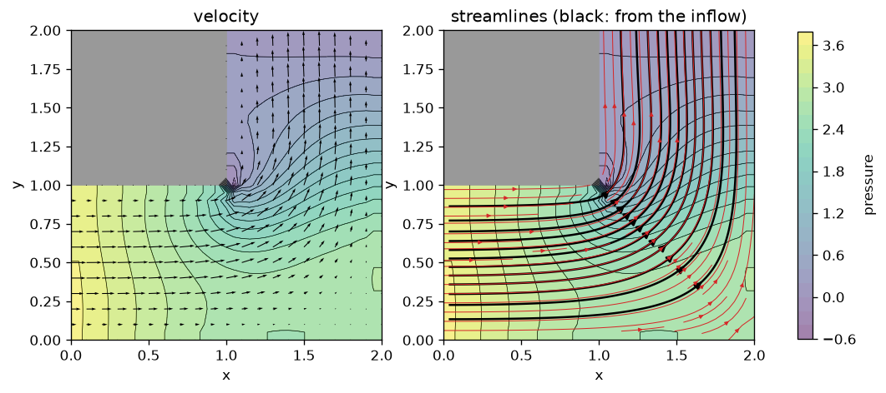

# Flow around a corner

The cavity is a closed box: no fluid gets in or out, and the flow is driven by the moving lid. Real problems usually have fluid coming in one place and leaving another. This case keeps the cavity's arithmetic and changes the problem: fluid flows along a channel, turns a right-angle corner, and leaves. Read `Serial-Walkthrough.md` first; this only describes what is different.

## The problem

The box is 2 by 2 again, but the top-left quarter is solid. That leaves an L-shaped channel whose two arms are each 1 wide. Fluid comes in through the left side below the block, turns the corner, and leaves through the top to the right of the block. The bottom, the right side and the faces of the block are walls.

    y = 2  +---------+.........+    <- outflow
           |  solid  |         |
    y = 1  +---------+         |
    inflow |                   |
     -->   |                   |
    y = 0  +-------------------+
          x = 0     x = 1     x = 2

The fluid enters with the parabolic profile of fully developed channel flow, mean speed 1, so the Reynolds number is U W / nu = 1 x 1 / 0.1 = 10.

Run it and draw it:

    python corner_serial.py             # 41 x 41, until steady
    python plot_corner.py corner-serial-41.npz

## What is reused, and what is new

`corner_core.py` imports `source` and `jacobi` from `cavity_core.py` and uses them unchanged. The pressure equation does not care about the shape of the region: it is the same Poisson equation, and only its boundary conditions change.

Three things are new.

The boundaries. In the cavity, the walls were set once and never touched, because every update covered only the interior. Here the inflow, the outflow and the block are all inside the array, so `velocity_bc` and `pressure_bc` reset them after every update:

| Boundary | Velocity | Pressure |
|---|---|---|
| Walls and block faces | u = v = 0 (no slip) | dp/dn = 0 |
| Inflow, x = 0, 0 < y < 1 | u = parabola, v = 0 | dp/dx = 0 |
| Outflow, y = 2, 1 < x < 2 | du/dy = dv/dy = 0 | p = 0 |

dp/dn = 0 means the derivative across the wall is zero, so each wall point copies the pressure of its neighbour in the fluid. At the block's corner, which has fluid on two sides, it takes the average of the two. The outflow conditions say the flow has stopped changing by the time it leaves, which is only true if the outlet is far enough downstream. That is something to test (below).

The convection term. Barba always takes the backward difference, `un[c] - un[r, :-2]`, for u du/dx. That is upwind, taking the difference from the side the fluid comes from, only where u is positive. In the cavity that is good enough. Around a corner there are regions where the fluid runs backwards, and a downwind difference there makes the scheme unstable. `velocity` picks the side by the sign of the velocity at each point, with `np.where`.

Steady state. The cavity ran a fixed 700 steps. This code stops when the largest change in u or v per unit time drops below 1e-3. At Re = 10 that takes about 1750 steps.

## Checking it: does what goes in come out?

Every 500 steps the code prints the volume flow in through the left side and out through the top. For a steady incompressible flow they must be equal. They are not quite:

| Grid | Flow in | Flow out | Short by |
|---|---:|---:|---:|
| 41 x 41 | 0.9975 | 0.9911 | 0.6 % |
| 81 x 81 | 0.9994 | 0.9961 | 0.3 % |

Raising the pressure sweeps from 50 to 200 changes nothing, so the pressure solve is not the cause. Halving dx halves the error, which is the signature of a first-order method: the upwind differences in the convection term are first order. (The flow in is not exactly 1 either, because the trapezoid rule on 20 or 40 intervals underestimates a parabola's area slightly.) This is the kind of check to make before trusting a picture.

## What the picture shows

- The pressure is high upstream and falls along the channel: it pushes the fluid against viscous drag.
- At the inner corner the pressure drops sharply and the contours crowd together. A sharp corner is a singular point: the exact solution has infinite velocity gradients there, so refining the grid never settles the values right at the corner.
- The fluid takes the inside of the bend. In the outer corner (near x = 2, y = 0) it is almost still.

At Re = 50 (set NU = 0.02 in `corner_core.py` and run `python corner_serial.py 81 40000`), two new things appear. The slow fluid in the outer corner closes into an eddy. And downstream of the inner corner the flow cannot follow the sharp turn: it separates from the block's right face, leaving a region of slow, reversed flow along it. These are the two features engineers designing pipe bends and ducts care most about.

## Things to try

- Raise the Reynolds number: NU = 0.05, 0.02, 0.01. How does the separated region along the block's face grow? At what point does the solution blow up, and does a finer grid or a smaller dt fix it?
- Make the outlet arm longer (a taller box, or a narrower block). Does the flow near the corner change? If it does, the outflow condition at y = 2 was too close.
- Replace the parabolic inflow with a uniform one, u = 1 everywhere across the inlet. How far down the channel does it take to become a parabola again?
- Use second-order upwind differences for the convection term and repeat the flow-in, flow-out table. How fast does the error fall now?
- Split this code across MPI ranks the way `cavity_mpi.py` splits the cavity. Which boundary conditions belong to which rank?
