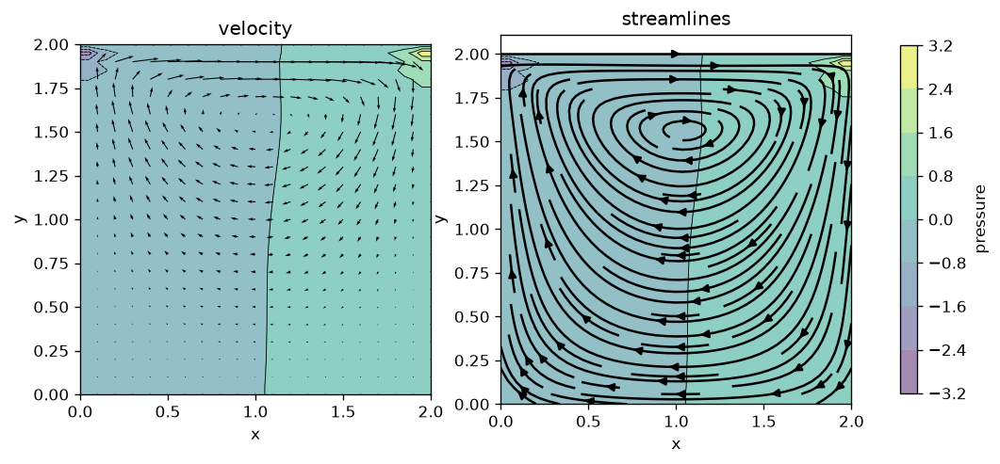

# Cavity flow, serial and parallel

This is Barba's Step 11, flow in a box with a moving lid, written twice: once on one process, and once split across MPI ranks the way `jacobi_mpi.py` splits Laplace's equation. Both versions run the same arithmetic, so you can check that the parallel answer is exactly right, and then see when splitting the work pays off.

## The files

| File | What it does |
|---|---|
| `cavity_core.py` | The arithmetic of one time step: the pressure source, a Jacobi sweep for the pressure, and the velocity update. Each function works on a band of rows, so both codes below can share it. |
| `cavity_serial.py` | Step 11 on one process. Prints the time per step and how it splits between the pressure solve and the velocity update. |
| `cavity_mpi.py` | The same, with the box cut into horizontal strips, one per rank. Prints the time per step and the share spent in halo exchanges. |
| `compare.py` | Checks an MPI run against the serial run, point by point. |
| `plot_cavity.py` | Draws a saved run: pressure contours, velocity arrows and streamlines. |
| `plot_source.py` | Draws the source term of the pressure equation, its two parts, and the pressure each part makes on its own. Serial walkthrough Step 6 explains it. |
| `Serial-Walkthrough.md` | The physics and numerics of `cavity_serial.py`, one step at a time. Read it first. |
| `MPI-Walkthrough.md` | How `cavity_mpi.py` is built from the serial code, one step at a time. |
| `jacobi_mpi.py` | Laplace's equation split across ranks: the simpler code `cavity_mpi.py` is modelled on. |
| `Dockerfile` | Python, NumPy, OpenMPI and mpi4py, so everyone has the same setup. |

The physics is Barba's: a 2 by 2 box, lid speed 1, density 1, viscosity 0.1, and a fixed 50 pressure sweeps per time step. Her grid is 41 by 41 with a time step of 0.001. On a finer grid the time step has to shrink to stay stable, and `cavity_core.grid()` does that for you.

## Running it

You need Docker. Build the image once, from this folder:

    docker build -t phys310-mpi .

Then run the codes, also from this folder:

    docker run --rm -v "$PWD":/work phys310-mpi python cavity_serial.py
    docker run --rm -v "$PWD":/work phys310-mpi mpirun -n 4 python cavity_mpi.py
    docker run --rm -v "$PWD":/work phys310-mpi python compare.py 41 4

Both scripts take the grid size and the number of time steps, for example `cavity_serial.py 1025 20`. With no arguments they run Barba's case, 41 by 41 for 700 steps.

`plot_cavity.py` and `plot_source.py` need Matplotlib, which the image does not have, so run them with your own Python:

    python plot_cavity.py cavity-serial-41.npz
    python plot_source.py cavity-serial-41.npz

## Is the parallel answer right?

Yes, exactly. `compare.py` finds the MPI fields identical to the serial ones, with a largest difference of zero, not just small, for every case below. That works because both codes do the same operations on every point, and a Jacobi sweep reads only the old values, so the order the points are visited in does not matter.

This is the check to make first. A parallel code that is fast and slightly wrong is worse than useless, and a halo bug usually shows up as a small error near the strip edges that a picture will not reveal.

## Where the time goes

On one process, about 90 % of every time step is the pressure solve, at all three grid sizes. Fifty Jacobi sweeps cost far more than one velocity update. If you guessed the velocity update, look at what each one does per point.

## What splitting it does

Time per step on one machine (a 6-core Intel i5, Docker with 6 CPUs), measured 2026-11-13:

| Grid | Steps | Serial | 1 rank | 2 ranks | 4 ranks | 6 ranks |
|---|---:|---:|---:|---:|---:|---:|
| 41 x 41 | 700 | 1.26 ms | 1.41 ms | 1.37 ms | 1.41 ms | |
| 257 x 257 | 100 | 32.6 ms | 32.2 ms | 16.1 ms | 10.8 ms | 8.3 ms |
| 1025 x 1025 | 20 | 648 ms | 624 ms | 479 ms | 463 ms | 476 ms |

Share of the time the slowest rank spends in halo exchanges:

| Grid | 1 rank | 2 ranks | 4 ranks | 6 ranks |
|---|---:|---:|---:|---:|
| 41 x 41 | 7 % | 21 % | 31 % | |
| 257 x 257 | 0.6 % | 6 % | 11 % | 33 % |
| 1025 x 1025 | 0.1 % | 2 % | 4 % | 21 % |

Three different stories:

- **41 x 41: no gain at all.** Each strip is about ten rows of 41 points. The arithmetic per sweep takes microseconds, and every time step needs 53 halo exchanges: one for u and v, one before each of the 50 pressure sweeps, and one after. The messages cost as much as the work they save.
- **257 x 257: a real speedup,** 3.9 times on 6 ranks. There is now enough work per strip to hide the messages, until 6 ranks, where a third of the time goes on exchanges.
- **1025 x 1025: disappointing,** at most 1.4 times, and 6 ranks are slower than 4. The halo share is small, so communication is not the reason. The likely one: each field is 8 MB, and the solver keeps several, far more than the processor's 9 MB cache. So every sweep streams the arrays through main memory, and all the cores share one path to it. Once that path is saturated, more cores just wait their turn. That limit is called memory bandwidth, and on one machine no amount of MPI gets past it. At 257 x 257 the whole problem fits in cache, which is why it scales.

The 1025 result is the one to think about. On a cluster the strips go to different nodes, and each node brings its own memory, so the same code can scale there when it cannot on a laptop.

## Things to try

- Find the smallest grid where 2 ranks beat 1 on your machine.
- Halve `NIT` in `cavity_core.py`. The time per step should almost halve, so what does that say about where the cost is? Barba never checks whether 50 sweeps are enough. Add a check, for the largest change in p during the last sweep, and see how far from converged the pressure is.
- Split the box into blocks instead of strips. For a fixed number of ranks, which sends less data per rank, and does it matter at these sizes?
- Run the 1025 grid on the cluster, across more than one node, and compare it with the table.
